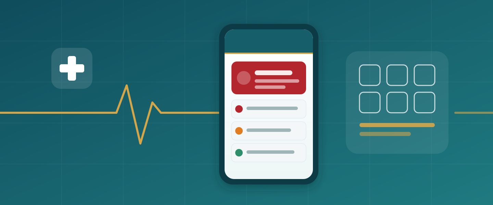
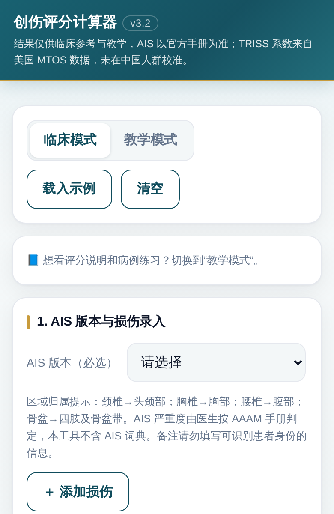
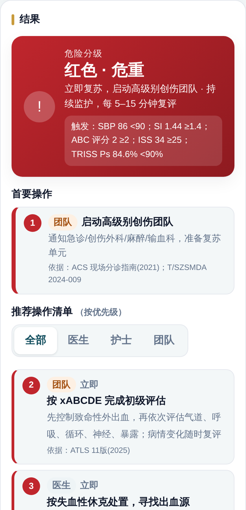

  

<h1 align="center">创伤评分计算器 · Trauma Score Calculator</h1>

  <strong>逐条录入损伤，一屏看到评分、危险分级和指南要点</strong> 
  Enter injuries one by one, get scores, risk tier and guideline prompts on one screen

  给急诊与创伤外科医生的离线单文件工具：ISS / NISS / RTS / TRISS / 休克指数 / GAP / MGAP / rSIG。 
  An offline single-file tool for emergency and trauma clinicians.

<h3 align="center">
  <a href="https://tuanziding.github.io/trauma-score-calculator/">▶ 在线打开 · Open the web app</a>
</h3>

  <a href="README.md">简体中文</a> · <a href="文档/英文说明v1.0.md">English</a>

  <code>离线 · 不上传数据</code> · <code>公式透明可追溯</code> · <code>三套公开数据外部验证</code> · <code>内置自检 34/34</code>

  <a href="#use-cases">使用场景</a> ｜ <a href="#showcase">实际界面</a> ｜ <a href="#quick-start">快速开始</a> ｜ <a href="#capabilities">能力状态</a> ｜ <a href="#validation">外部验证</a> ｜ <a href="#contribute">参与共创</a>

封面为概念示意图（SVG 自绘），不是真实截图。

> ⚠️ 仅供临床参考与教学，不构成医嘱，不是医疗器械。AIS 严重度须由医生依 AAAM 官方手册判定；本工具不含 AIS 词典。

---

## 用在哪里 · Use cases

| 你想做什么 | 可以怎样开始 |
| --- | --- |
| 抢救室里快速判断伤情轻重 | 录入 GCS、SBP、HR、年龄，立刻得到 GAP / MGAP / rSIG、休克指数和危险分级 |
| 病历或质控需要 ISS / TRISS | 按 AAAM 手册逐条录入 AIS，自动算 ISS、NISS、RTS、TRISS，并显示计算过程 |
| 核对手工 AIS 是否漏项 | 粘贴病案首页 ICD-10 编码，粗估 ISS 并提示复核（实验性） |
| 带教规培生、考核评分一致性 | 切到教学模式：双人对比录入、评分小课堂、病例练习 |

## 实际界面 · Showcase

| 临床录入 | 危险分级与操作提示 |
| --- | --- |
|  |  |
| [在线打开 →](https://tuanziding.github.io/trauma-score-calculator/) | [在线打开 →](https://tuanziding.github.io/trauma-score-calculator/) |

真实截图（v3.2，手机宽度 390 px）；右图为虚构示例病例：头颈 AIS 4、胸 3、四肢 3，SBP 86，HR 124。

## 先用起来 · Quick start

1. 手机或电脑浏览器打开 **[在线版](https://tuanziding.github.io/trauma-score-calculator/)**；iPhone 可点“分享 → 添加到主屏幕”。
2. 离线使用：下载 [`index.html`](index.html)，用 Safari / Chrome 打开即可，无需安装、不联网。
3. 先选 AIS 版本，再逐条添加损伤、填写生理参数；结果区实时更新，可复制或打印为 PDF。

注意：部分 App 内的文件预览会禁止运行脚本，结果区会空白，请改用浏览器打开。

## 怎么算的 · Workflow

**录入损伤与生命体征 → 计算评分并自检 → 危险分级 → 指南要点提示（标注出处）**

| 想做的事 | 项目怎样支持 |
| --- | --- |
| 看懂分数从哪来 | 每个评分都显示逐步计算过程和公式来源 |
| 知道下一步做什么 | 红 / 橙 / 黄 / 绿分级，首要操作 + 按医生 / 护士 / 团队筛选的清单 |
| 信得过结果 | 页面加载即运行 34 项边界自检，未通过则停用结果 |

## 当前做到哪一步 · Capability status

| 状态 | 内容 | 实际边界 |
| --- | --- | --- |
| 已实现 · 已验证 | ISS / NISS / RTS / TRISS / 休克指数 | TRISS 与 CRAN `traumar` 比对，最大差 2.2×10⁻¹⁶ |
| 已实现 · 已验证（v3.2） | GAP / MGAP / rSIG | TITCO、CRASH-2 外部验证；只显示，不参与分级 |
| 已实现 · 部分验证 | 危险分级与操作提示 | 阈值经三套数据检验；插管、FAST、抗凝等条件未经数据检验 |
| 实验性（v3.2） | ICD-10 估算 ISS 交叉核对 | 与手工 AIS 一致性低（Spearman 0.46），只作复核提示 |
| 计划中 | 创伤指数 TI、国家质控格式导出、批量质控 W/M/Z | — |

<strong>指南与公式来源 / Sources</strong>

ATLS 11 版；欧洲创伤大出血与凝血病指南第 6 版（2023）；创伤失血性休克中国急诊专家共识（2023）；ACS 现场分诊指南（2021）；ACS TQIP 大量输血指南；CRASH-2；BTF 重型颅脑损伤指南第 4 版。
ISS：Baker 1974；NISS：Osler 1997；RTS：Champion 1989；TRISS：Boyd 1987、Champion 1995；GAP：Kondo 2011；MGAP：Sartorius 2010；rSIG：Kimura 2018。

## 外部验证 · External validation

用工具自身计算核心在三个公开国际数据集上检验（结局：院内死亡，AUC），详见 [验证报告](validation/validation_report.md)。

| 数据集 | 结果 |
| --- | --- |
| TITCO-I（印度，14,755 例） | TRISS 0.830，RTS 0.832，GAP 0.837，MGAP 0.831，rSIG 0.815 |
| CRASH-2（40 国，20,207 例） | RTS 0.808，GAP 0.793，rSIG 0.789，MGAP 0.767 |
| UVA（美国，18,680 例） | ISS 0.821，NISS 0.817 |

校准警示：MTOS 系数在 TITCO 中显著低估死亡（预期 383 例，实际 1,479 例）。均非中国数据。原始患者级数据不随仓库分发。

<strong>开发与复现 / Development</strong>

修改 `src/ui.html`、`src/core.js`、`src/lesson.html`、`src/icdmap.js` 后运行 `python3 build.py` 生成 `index.html`。
数据下载到 `validation/data/` 后：`cd validation/scripts && python3 prep.py && node run.js && Rscript impl.R && python3 metrics.py && node tiers_v3.js`；v3.2 新增脚本见验证报告“复现”一节。

## 一起把它做得更好 · Contribute

欢迎急诊、创伤、护理和质控同行提出建议，尤其是中国本地数据校准、TI 评分和质控上报格式。

| 你想了解什么 | 从这里进入 |
| --- | --- |
| 在线使用 | [打开网页版](https://tuanziding.github.io/trauma-score-calculator/) |
| English overview | [English homepage](文档/英文说明v1.0.md) |
| 验证方法与结果 | [验证报告](validation/validation_report.md) |
| 第三方许可 | [THIRD_PARTY_NOTICES](THIRD_PARTY_NOTICES.md) |
| 建议或问题 | [GitHub Issues](https://github.com/TUANZIDING/trauma-score-calculator/issues) |

---

  <strong>创伤评分计算器 · Trauma Score Calculator</strong> 
  把评分算对，把时间留给病人。 
  <a href="https://github.com/TUANZIDING">TUANZIDING</a> · 丁海祥 Haixiang Ding, MD · Emergency and Trauma Surgeon

TRISS 与 <a href="https://github.com/bemts-hhs/traumar">bemts-hhs/traumar</a>（MIT）比对验证；ICD-10 映射表来自 <a href="https://github.com/ablack3/icdpicr">ICDPIC-R</a>（MIT）。感谢 TITCO、CRASH-2 与 UVA 数据的公开共享。本仓库尚未选定开源许可证。
